# Install & User Guide

Everything you need to install the **Kraken AD&D 2E Character Wizard**, know where it goes, and how to use the wizard.

> 🎥 **Prefer to watch?** See the [video walkthrough on YouTube](https://youtu.be/DUrpYcwq9xY).

---

## 1. What's in the download

From the [latest Release](../../releases/latest) (what changed: [Changelog](CHANGELOG.md)):

| File | What it is | Where it goes |
|------|------------|---------------|
| **`KrakenCharWizard2E.ext`** | The extension — the character-creation wizard itself | your Fantasy Grounds **`extensions\`** folder |
| **`Kraken.AD.D.2E.Character.Wizard.zip`** | The same extension in an `extensions\` folder, plus a Read Me | unzip it straight into your Fantasy Grounds **data folder** |

Take either one; only the GM needs it.

---

## 2. Where to put it

Your Fantasy Grounds **data folder** is usually:

```
%appdata%\SmiteWorks\Fantasy Grounds
```

(Paste that into the Windows Explorer address bar, or click the **folder icon** on the Fantasy Grounds launcher screen.)

```
Fantasy Grounds\                      <- your data folder
└── extensions\
    └── KrakenCharWizard2E.ext        <- the extension goes here
```

That's it — no unzipping, no subfolders.

---

## 3. What you must already own

These are commercial SmiteWorks products and are **not** included:

- **Fantasy Grounds Unity**
- **The AD&D 2E ruleset**
- **The 2E Player's Handbook module** — the wizard reads **races, classes, kits, spells, equipment and nonweapon proficiencies** from it. Without it, those lists will be empty.

Any other official 2E books you load are used too — tested with the Dungeon Master Guide, Monstrous Manual, Tome of Magic, the Complete Fighter's, Thief's, Priest's, Wizard's, Bard's, Ranger's, Paladin's, Druid's and Barbarian's Handbooks, the Complete Books of Dwarves, Elves, Gnomes & Halflings and Humanoids, the Complete Book of Necromancers and Demihuman Deities. Their races, classes (including the specialty priests of the demihuman gods), kits, gear and proficiencies appear in the wizard on their own.

---

## 4. Turn it on

1. Launch Fantasy Grounds and load a **2E campaign as the GM/host**.
2. On the campaign **load screen**, click **Extensions** and tick **Kraken AD&D 2E Character Wizard**.
3. Once in the game, open **Library → Modules** and activate your **Player's Handbook** and any other 2E books you want to offer.
4. Open the **Characters** list — there's a wizard button to launch it.

**Players** use it the same way: after joining, open **Characters** and click the wizard icon. **Create Character** asks the GM's table for a new character sheet that the player owns, just like the **+** on Character Selection, so the campaign needs a free character slot. The GM only has to enable the extension; players don't install anything.

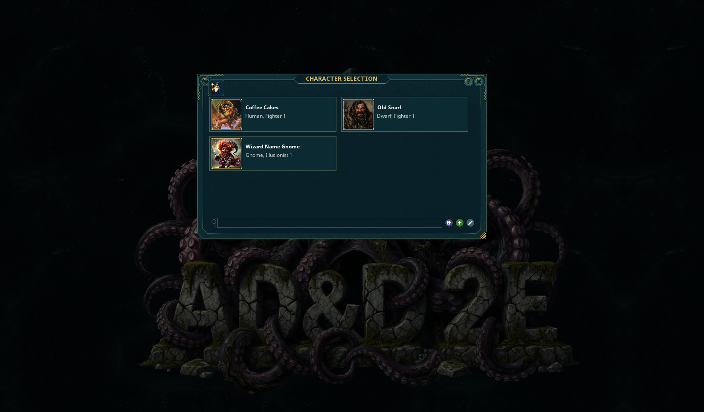

### Players

Since v1.0-beta4 players build their own characters. On a player's screen, **Characters** shows the same wizard icon:

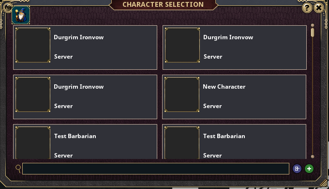

They go through the tabs like the GM; on **Commit**, **Create Character** asks the GM's table for a new sheet the player owns (chat says *asking the GM's table for a new character sheet…*), and the wizard fills it in:

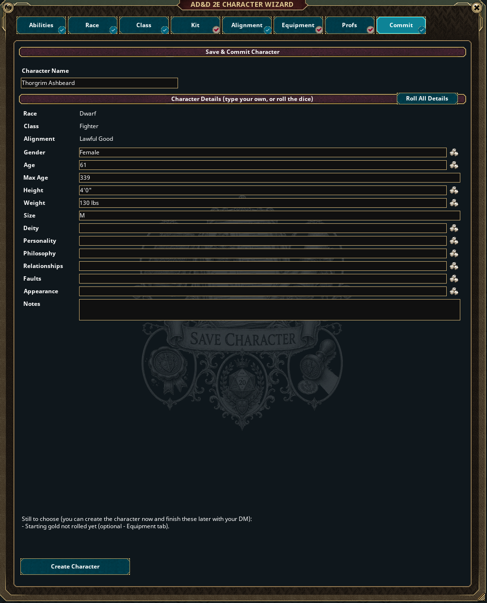


If nothing arrives, the campaign may have no free character slot: the choices stay in the wizard, so the player can try again once the GM frees one.

---

## 5. DM Options (GM controls)

Open **Options** (the gear / settings menu). Under **Kraken Character Wizard** you control what players may do:

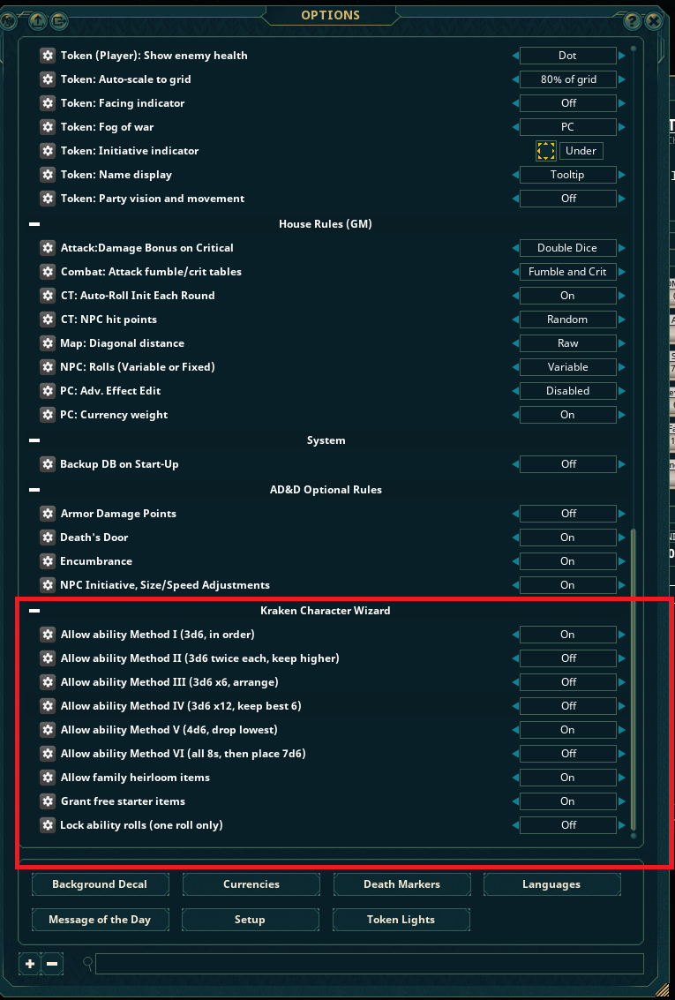

- **Allow ability Method I–VI** — turn each PHB ability-score method on or off. Only the ones you allow appear in the player's dropdown.
- **Grant free starter items** — gives each character its class item (holy symbol, spellbook, thieves' picks, an instrument...) and an Adventure Pack at no gold cost.
- **Lock ability rolls (one roll only)** — players get a single roll, no re-rolling.
- **Allow family heirloom items** — only for campaigns with a module that provides the heirloom items; without one the heirloom roll simply doesn't appear.
- **Starting gold above 1st level** — for a character made above 1st level (the PHB leaves extra funds to the DM): *PHB (one roll)* keeps the normal Table 43 roll; *One roll per level* rolls the class group's Table 43 dice once per level and adds them up (recommended: everyone of the same level ends up about equally equipped); *Roll x level* multiplies one roll by the level. Both give the same average, about 625 gp for a 5th-level warrior. Priests always keep only 3 gp of what is left after shopping (PHB Table 43).

---

## 6. Build a character — tab by tab

The wizard runs left to right. Each tab gets a ✓ when its required choices are made. Every list only offers what the choices before it allow.

### Abilities
Pick a generation method from the dropdown (only the methods your DM allowed are listed), then roll. Some methods let you **roll each attribute individually** (the dice icons) or **drag scores to arrange** them; the panel explains the selected method.

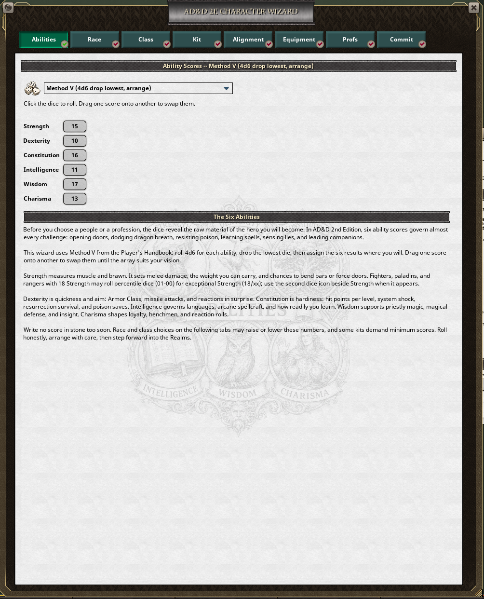

### Race
Choose from every race your books provide. Use the **Source** and **Name** filters to narrow the list, and click the shield to open the full library record. Races your scores fall outside of (PHB Table 7, or a splatbook race's own Ability Score Range) are not listed.


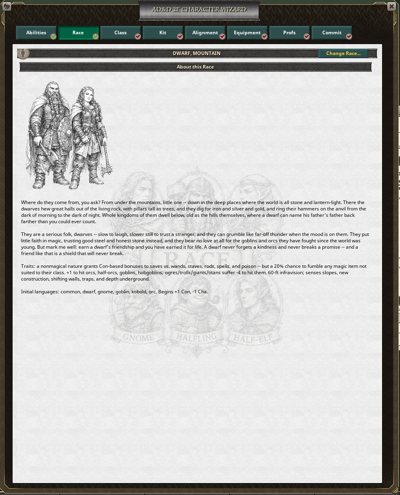

### Class
Pick your class and set your **starting level**. The list holds only classes your race may take (PHB Table 7) and your scores qualify for (the PHB minimums, or the class's own REQUIREMENTS), after racial adjustments. Splatbook classes are here too: here a mountain dwarf sees the specialty priests of Demihuman Deities. Class drives your THAC0, saves, hit dice, proficiency slots, weapons, armor and spells.


### Kit
Optional. Kits are filtered to your class, race and scores; pick one or choose **No Kit**.

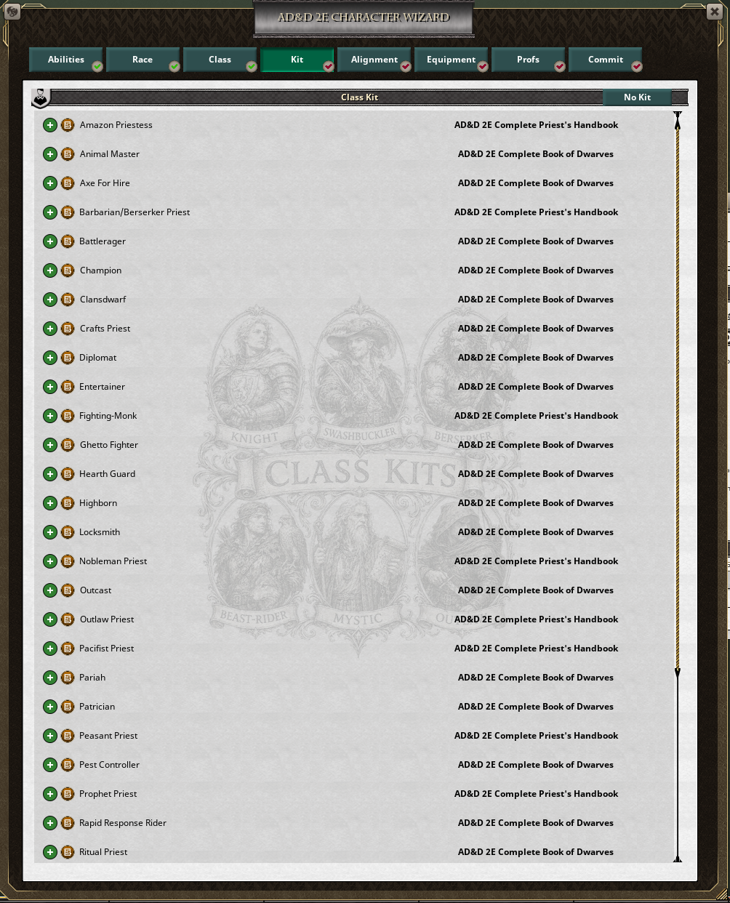

### Alignment
Pick from the alignments your class allows (paladins lawful good, druids true neutral, and so on).

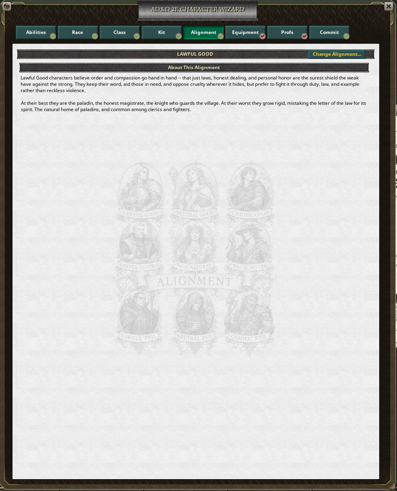

### Equipment
Your **starting gold** is rolled by class group. Then:
- **Free Starter Kit** — if your DM grants it, add your class item and an Adventure Pack at no cost.
- **Buy gear** — a shop of what your class can actually use: its weapons, the armor it may wear (warriors and priests any; druids leather and a small wooden shield; thieves leather, padded, studded leather or elven chain; bards up to chain mail; mages none), ammunition only for launchers it can use, and everyday gear from the Player's Handbook and your class's own Complete Handbook. The list is sorted by type — Armor, Weapons, Ammunition, Gear — with a **type dropdown** to show just one and a **Search** box for names. Anything your gold no longer covers drops off the list as you buy. Magic items are never offered at creation.


### Proficiencies
Spend your slots:
- **Weapon Proficiencies** — only weapons your class may use are listed.
- **Languages** — your racial languages are known; spend your Intelligence bonus on extras.
- **Nonweapon Proficiencies** — pick any; a `[2]` after a name means it costs **2** slots.
- **Spells** — casters pick their starting spells.

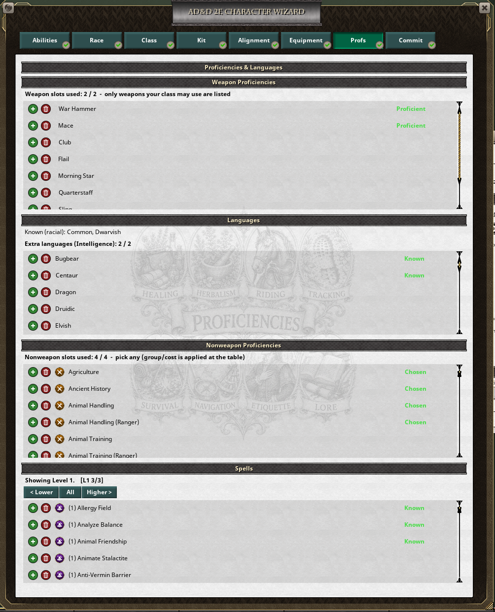

### Commit
Name the character and fill in the details — type your own or click a dice icon to roll one (or **Roll All Details**). Then click **Create Character**.

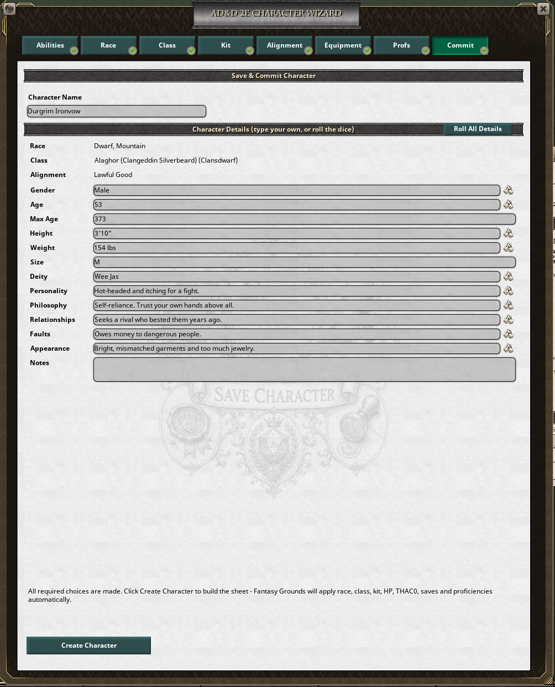

You can create at any point. If choices are still open (say you are making the character before game night without your DM), the character is saved anyway and the open choices are listed at the top of its notes, to finish with your DM:

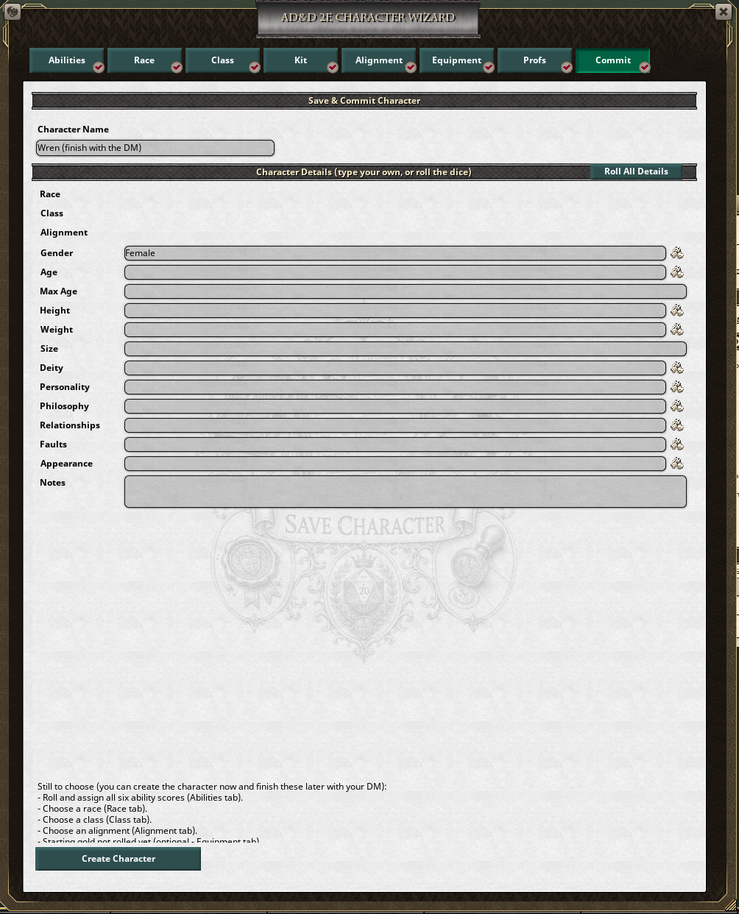

---

## 7. The finished sheet

Click **Create Character** and the wizard builds a complete 2E sheet — abilities (with derived stats), saves, **AC**, THAC0, HP, race traits, kit, proficiencies, languages, spells, gold split into coins, and your gear:


---

## 8. Troubleshooting

| Symptom | Likely cause / fix |
|--------|--------------------|
| No wizard button | The GM hasn't enabled the extension on the load screen. |
| A player's Create Character makes no sheet | The GM's table gave no new character (no free character slot?). The choices stay in the wizard; try again. |
| Race / Class / Spell / Proficiency lists are empty | The 2E **Player's Handbook** module isn't active (or isn't owned). |
| A race or class you expected is missing | Your rolled scores don't qualify for it, or your race may not take that class — reroll or rearrange your scores. |
| Nothing to buy | Roll your starting gold first; the shop only lists what your purse covers. |
| An older character looks wrong (AC, coins, etc.) | Fixes apply when a character is **created** — build a fresh one; the wizard doesn't retro-edit existing sheets. |

---

## 9. Updating later

When a new [Release](../../releases/latest) comes out, replace `KrakenCharWizard2E.ext` in `extensions\` with the new one (same filename) and restart Fantasy Grounds.
