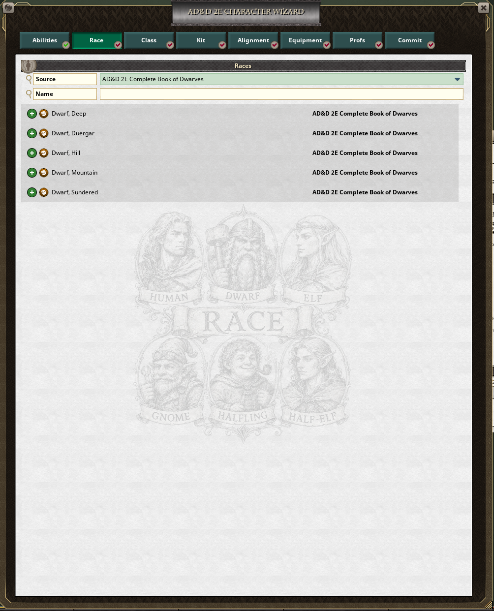
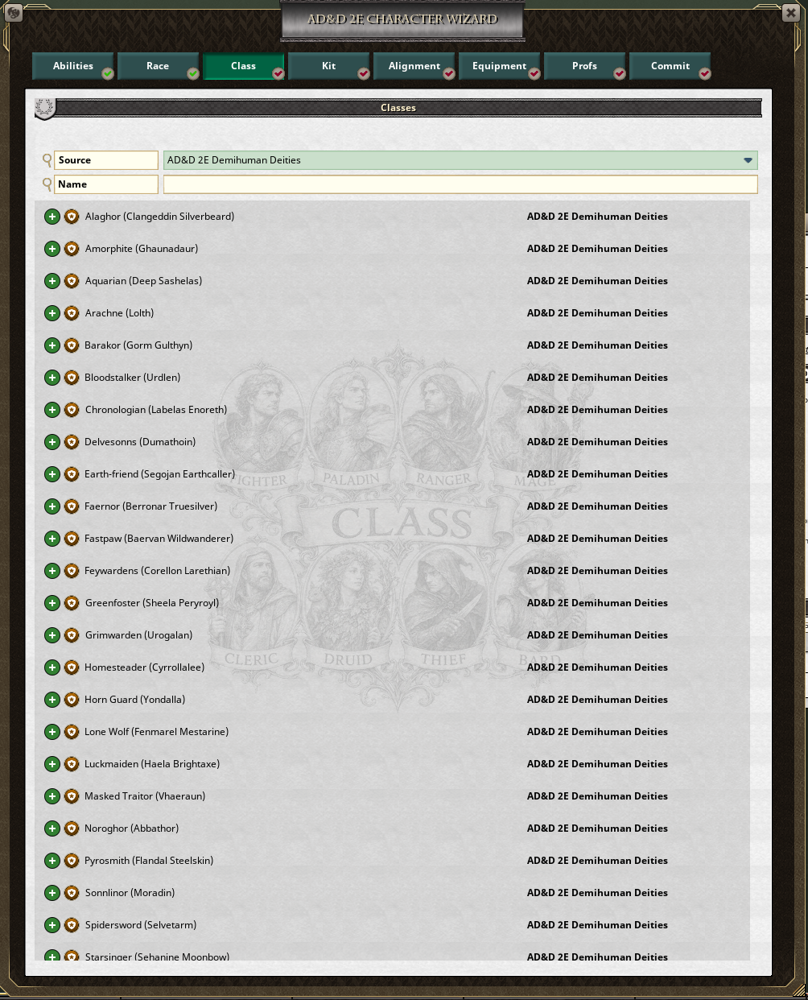
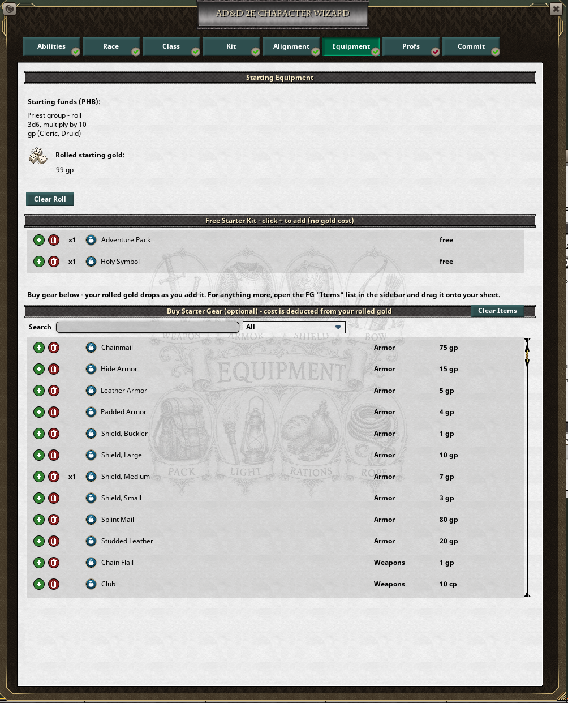
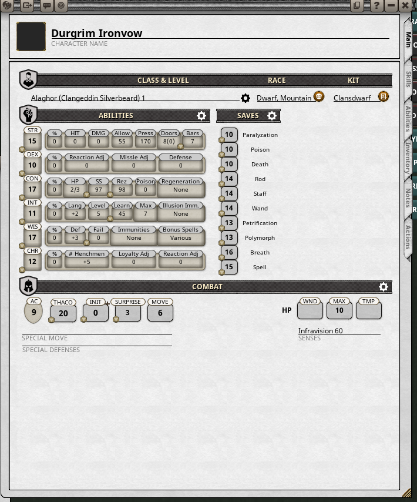
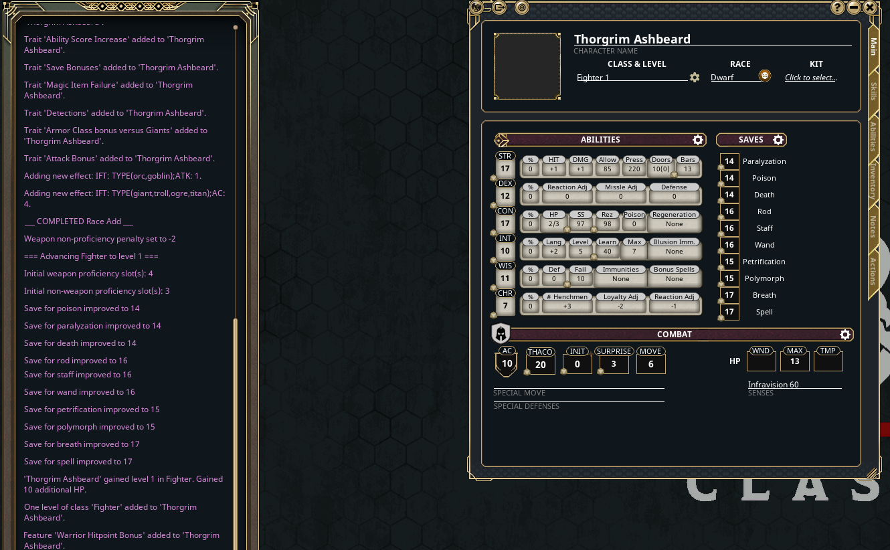

# Kraken AD&D 2E Character Wizard

A guided character-creation wizard for **AD&D 2nd Edition** in **Fantasy Grounds Unity**, styled after the 5E Character Wizard.

Tabbed flow: **Abilities → Race → Class → Kit → Alignment → Equipment → Proficiencies → Commit.**

It reads the official 2E books you have loaded: the **Player's Handbook**, plus any of the Complete Handbooks, the Complete Books of Dwarves, Elves, Gnomes & Halflings and Humanoids, Demihuman Deities, the Complete Book of Necromancers and Tome of Magic. Their races, classes (specialty priests included), kits, gear and proficiencies show up on their own.

> 📖 **New here? Read the [Install & User Guide](GUIDE.md)** — what to install, where it goes, the DM options, and a screenshot walkthrough of every tab.

> 🆕 **v1.0-beta7: spells get their own tab after Kit, with spells per level, school or sphere filters and picked/allowed counts; bards, paladins and rangers cast; weapon proficiencies tick on every attack of a weapon.** v1.0-beta6: proficiency slots by level, starting gold option above 1st level, priests return leftover gold. Every change is in the **[Changelog](CHANGELOG.md)**. Download: **[latest release](../../releases/latest)**.

## 🎥 Demo

[](https://youtu.be/DUrpYcwq9xY)

*A walkthrough of building a character with the wizard — [watch on YouTube](https://youtu.be/DUrpYcwq9xY).*

## Screenshots

**Every race your books provide** (here the Complete Book of Dwarves), filtered by the scores you rolled



**Classes your race and scores allow** — specialty priests from Demihuman Deities included



**A shop of the gear your class can use and your purse can pay for**



**…and the wizard builds a complete 2E sheet — abilities, saves, AC, THAC0, HP, kit, gear**



**Players build their own** — on a player's screen, Create Character gets a sheet from the GM's table and the wizard fills it in



> The full tab-by-tab walkthrough (with every screen) is in the **[Install & User Guide](GUIDE.md)**.

## What it does for you

- **Filters as you go.** Races outside your rolled scores, classes your race may not take or your scores don't qualify for (PHB minimums, or a splatbook class's own requirements), kits your class, race or scores don't allow, and alignments your class forbids are not offered.
- **A shop that makes sense.** Sorted by type (armor, weapons, ammunition, gear) with a type filter and search. Weapons your class may use, armor it may wear (no plate for a mage), ammunition only for launchers it can use, everyday gear from the Player's Handbook and your class's own handbook — and only what your rolled gold still covers. Magic items are never in the starting shop.
- **Players build their own.** A player opens **Characters** after joining and clicks the wizard icon; **Create Character** asks the GM's table for a new character sheet that the player owns (as the **+** on Character Selection does). Before 1.0-beta4 only the GM could create characters with it.
- **Save unfinished.** Make a character before game night without your DM: **Create Character** works at any point, and whatever is still open is listed at the top of the sheet's notes to finish together.

## Install

Only the **GM** installs it. Grab the latest [**Release**](../../releases/latest) and:

1. Put `KrakenCharWizard2E.ext` in your Fantasy Grounds data folder under `extensions\` — or unzip the release's `.zip` straight into the data folder (it holds `extensions\KrakenCharWizard2E.ext` and a Read Me).
   - The data folder is usually `%appdata%\SmiteWorks\Fantasy Grounds` (or click the folder icon on the Fantasy Grounds launcher).
2. Launch FGU, select your 2E campaign, click **Extensions** on the load screen, tick **Kraken AD&D 2E Character Wizard**, and start the campaign.
3. In game, open **Library → Modules** and activate the **Player's Handbook** (and any other 2E books you want the wizard to use).
4. Open **Characters** and click the wizard icon (top-left) to build a character.

**Players** don't install anything: Fantasy Grounds sends them the extension when they join. They open **Characters**, click the wizard icon, and **Create Character** makes a sheet they own (the campaign needs a free character slot).

**Updating:** replace the `.ext` with the new one (same name) and restart Fantasy Grounds. See the [Changelog](CHANGELOG.md) for what changed.

### Requirements (commercial — not included)
- Fantasy Grounds Unity
- The AD&D 2E ruleset
- The 2E **Player's Handbook** module — races, classes, kits, spells, equipment and nonweapon proficiencies are read from it. Without it those lists are empty.

## Develop / release

This repository **is** the live extension folder — edit in place and FGU loads it live.

Cut a release (rebuilds the `.ext` and publishes it as a GitHub Release asset):

```sh
python release.py             # tag from extension.xml version, e.g. v1.0-beta7
python release.py v1.0-beta7  # explicit tag
```
